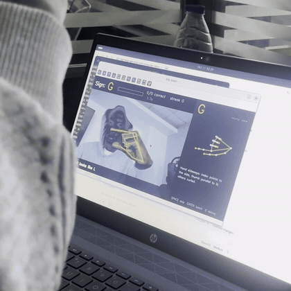
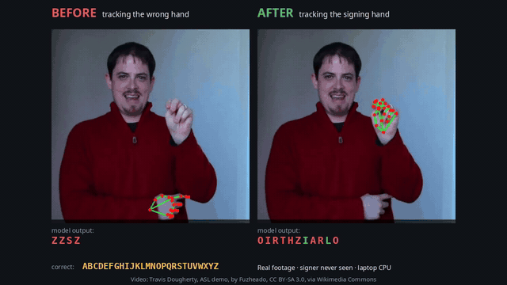

# ASL Fingerspelling: Tutor + Video Translator

A computer-vision project that recognises American Sign Language fingerspelling (A–Z) from a camera or a video,
on a laptop CPU with no GPU. One recognition model powers two modes:

| Mode | What it does | Input | Output |
|---|---|---|---|
| **1. Tutor** | Teaches the alphabet: shows a target letter, watches your hand live, tells you if it's right and what to fix, tracks progress | Webcam | Live feedback, progress stats |
| **2. Video translator** | A real-world test: runs any fingerspelling video through the model and subtitles it | A video file (own recording or real-world footage) | Captioned MP4 + `.srt` subtitles |

| The tutor in use | First real-world test: before and after fixing which hand is read |
|---|---|
|  |  |

<sub>Real-world test video: Travis Dougherty, ASL demo, by Fuzheado,
[CC BY-SA 3.0](https://commons.wikimedia.org/wiki/File:American_Sign_Language_demo_-_Travis_Dougherty.ogv), via Wikimedia
Commons. The before/after animation is an adaptation and is CC BY-SA 3.0 as well.</sub>

**Follow the build:** [build log on my site](https://mhvvd.github.io/blog.html) · [step-by-step journal](docs/journal/) ·
[walkthrough notebooks](notebooks/)

## Pipeline
```
frame ─▶ MediaPipe hand landmarks (21 pts) ─▶ pixel space ─▶ normalize (position/size/hand) ─▶ classifier ─▶ letter
                                                                                                   │
                     Tutor:  compare to target letter, give feedback ◀──────────────────────────────┤
                     Video:  smooth over frames ─▶ steady letters ─▶ words ─▶ subtitles ◀──────────┘
```

## Results so far
| Test | Accuracy |
|---|---|
| Public signer, held-out frames | 95.0% |
| **A new session of my own hand** (model trained on public data + my 3 earlier sessions) | **≈ 70–73%** (varies a little between training runs) |
| Same, public data only | 42.4% (a model of one person does not transfer to another) |
| Spelling words from real held-out frames, after smoothing | 0.19 character error rate |
| **Real-world video: a stranger fingerspelling A–Z** | **12 / 26 letters** (up from 1/26 after fixing which hand is read; journal 11) |
| **ChicagoFSWild test set: 36 real-world signers never seen** (sequence model trained on 87 others) | **67.3% letter accuracy** (per-frame system: 25.3%; journal 12) |
| **Fresh clips, answer keys written before scoring** (2 new signers, 25 letters, scored once) | **88%** sequence model vs 40% per-frame; CAMPYLOBACTER read perfectly at ~6 letters/s (journal 13) |

Weakest letters: thumb-position fists (M, N, S, T), crossed/spread pairs (R/U/V), letters signed pointing down (P, Q),
and letters signed inconsistently between sessions. The debugging stories (two mirroring bugs, the wrong-hand bug) are in the journal.

## Status
| Stage | Status |
|---|---|
| 1 Capture · 2 Landmarks · 3 Features | done |
| 4 Data: recorder with reference panel + live hand check, public ASL Alphabet extraction (65,707 samples), 4 personal sessions | done |
| 5 Training + evaluation: NumPy-only MLP, 73 KB, 0.08 ms/frame | done |
| 6 Smoothing (letter stream, double letters, spaces) + shared frame pipeline | done |
| 7a Tutor: spaced repetition, hold-to-confirm, finger-level tips (2.4% false alarms), teach mode, debug view | done, in use |
| 7b Video translator: captioned MP4 + SRT, two-hand aware, 33–55 frames/s on CPU | done; real-world test 12/26 letters |
| Next: many-signer data and a sequence model (ChicagoFSWild), motion letters J and Z | in progress |

## Built for a laptop CPU
Runs on an Intel i5-8265U with no GPU required. The runtime needs only OpenCV, MediaPipe and NumPy (no PyTorch).
The classifier is 18k parameters (73 KB) and costs well under 0.1 ms per frame; MediaPipe (~15–25 ms) is the only real cost.

## Setup
```bash
git clone https://github.com/MHVVD/asl-fingerspelling-cv.git && cd asl-fingerspelling-cv
python3 -m venv .venv && source .venv/bin/activate
pip install -r requirements.txt
# MediaPipe's hand landmark model (~7.8 MB, from Google):
mkdir -p models && curl -fsSL -o models/hand_landmarker.task \
  https://storage.googleapis.com/mediapipe-models/hand_landmarker/hand_landmarker/float16/latest/hand_landmarker.task
```
The trained letter model (`models/letter_mlp_final.npz`) and tip table (`models/finger_states.json`) are included,
so the tutor and translator run straight away. To retrain from scratch you also need the public dataset (below).

## Usage
```bash
source .venv/bin/activate
PYTHONPATH=src python -m aslcv.tutor_app       # the tutor (SPACE skip, ENTER teach, D debug, ESC quit)
PYTHONPATH=src python -m aslcv.translate my_clip.mp4   # captioned video + .srt into outputs/
PYTHONPATH=src python -m aslcv.record_clip     # record a test clip into clips/
PYTHONPATH=src python -m aslcv.record          # record your own training samples (reference hand shown on the right)
PYTHONPATH=src python -m aslcv.extract_public  # landmarks from the Kaggle ASL Alphabet set in data/raw/
PYTHONPATH=src python -m aslcv.train           # train + evaluate (writes models/ and artifacts/)
PYTHONPATH=src python -m aslcv.score_clip CLIP --truth WORD --name RUN   # score a clip with a known answer
python -m pytest -q                            # tests
```

## Notebooks
Three runnable walkthroughs that need no webcam and use only data in this repo
(open with `pip install jupyter && jupyter lab`):

| Notebook | What it shows |
|---|---|
| [01 · From a hand to 63 numbers](notebooks/01_hand_to_features.ipynb) | the 21 landmarks, normalization, and my hand vs. the reference model |
| [02 · Training and evaluating](notebooks/02_train_and_evaluate.ipynb) | session-based split, logistic regression vs. MLP, confusion matrix, model size and speed |
| [03 · From frames to subtitles](notebooks/03_smoothing_and_subtitles.ipynb) | the letter stream on real frames, double letters, word breaks, `.srt` output, the real-world result |

## Data
- `data/recorded/`: my own recordings: 4 sessions of hand **landmarks** (21 points × 3 numbers per frame, no images),
  made with `aslcv.record`. Sessions 1 and 3 were repaired for mirroring bugs; see journals 05 and 07.
- Public data (not included): the [ASL Alphabet](https://www.kaggle.com/datasets/grassknoted/asl-alphabet) dataset on Kaggle.
  Download it into `data/raw/`, then run `aslcv.extract_public` to create `data/public/asl_alphabet.npz`.

## License
Code and my recorded data: [MIT](LICENSE). Third-party material keeps its own license: the real-world test video and the
before/after animation are CC BY-SA 3.0 (see above), MediaPipe's hand model is Google's and is downloaded separately under its own terms, and the Kaggle dataset
is not redistributed here.
